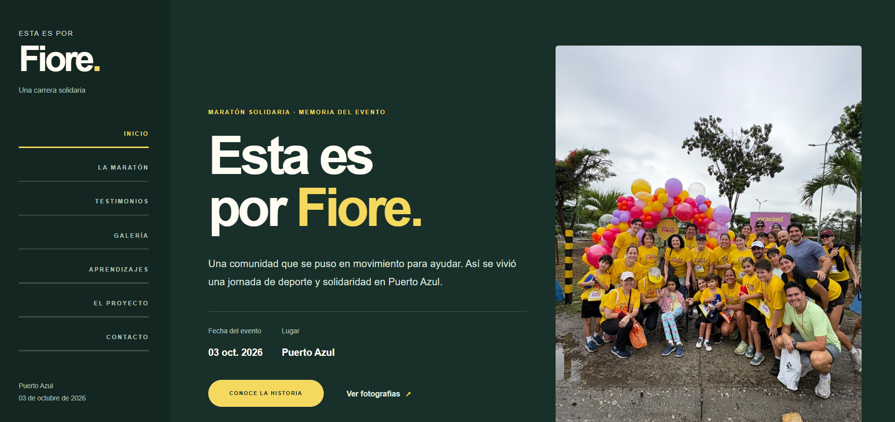
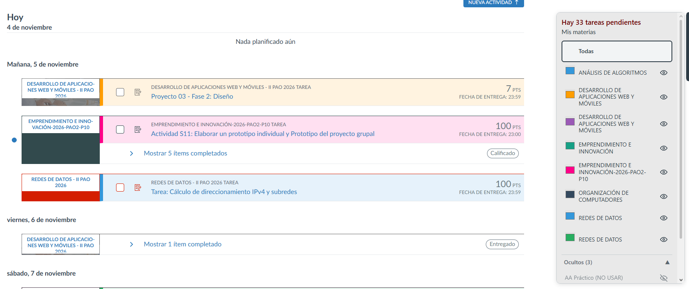
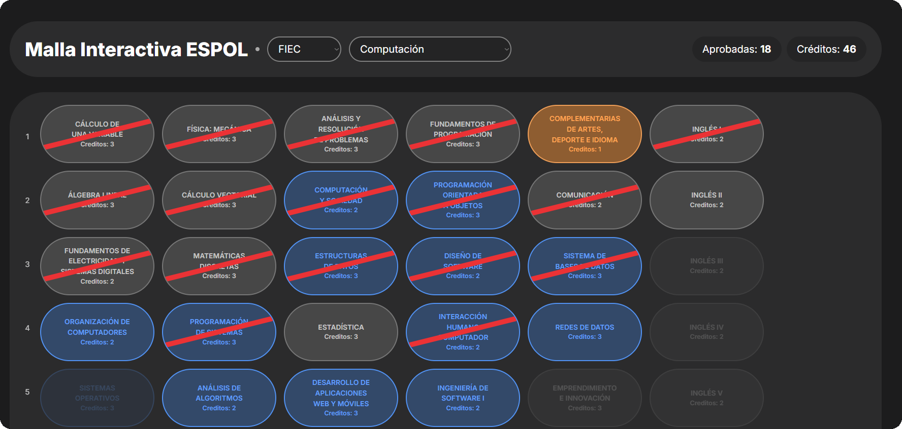

# 👋 Hi, I'm Arihuz Icaza

### Computer Engineering Student at ESPOL

I am a Computer Engineering student interested in software development,
data structures, electronics, and embedded systems.

I enjoy building academic projects that allow me to apply programming
concepts and solve problems through technology.

## 💻 Technologies and Skills

- **Languages:** Java and C
- **Computer Science:** Data Structures, Object-Oriented Programming and Concurrency
- **Electronics:** Arduino, sensors and electronic circuits
- **Tools:** Git, GitHub, NetBeans and Visual Studio Code

### 🛠️ Technologies in Practice

Throughout my academic projects, I've had the opportunity to explore different technologies and apply them to real-world problems.

| Technology | How I've Used It |
|---|---|
| HTML | Building the structure and content of web pages, including Proyecto por Fiore. |
| CSS | Designing layouts, improving visual presentation, and adapting websites to different screen sizes. |
| JavaScript | Developing interactive features and subject filters for my ESPOL Virtual Classroom Organizer. |
| TypeScript | Working with typed components and application logic in the ESPOL Interactive Curriculum project. |
| React | Building reusable interface components for interactive web applications. |
| Tailwind CSS | Styling and organizing the visual interface of the interactive curriculum. |
| Markdown | Writing documentation and organizing information in GitHub repositories. |
| Git & GitHub | Managing project versions, tracking changes, and collaborating through repositories. |
| GitHub Pages | Publishing web projects and making them accessible online. |

## 🚀 Featured Projects

Here are some of the projects I've worked on during my academic journey, exploring different technologies and solving problems through programming.

### 🌸 Proyecto por Fiore

A website created to share information about a charity sporting event, including participant experiences, photographs, and event details.

**Technologies:** HTML, CSS, GitHub Pages

- [View Repository](https://github.com/Arihuz124/Proyecto-por-Fiore)
- [Live Demo](https://arihuz124.github.io/Proyecto-por-Fiore/)

### 📚 ESPOL Virtual Classroom Organizer

A browser extension designed to improve the organization of academic activities by providing subject filters, color customization, and pending task information.

**Technologies:** JavaScript, CSS, Browser Extensions

- [View Repository](https://github.com/Arihuz124/Extension-Canva-aula-virtual-ESPOL)

### 🎓 ESPOL Interactive Curriculum

An interactive academic curriculum interface that helps students visualize courses and track their academic progress.

This project **is based on an existing open-source implementation**, with personal adaptations and improvements.

**Technologies:** React, TypeScript, Tailwind CSS

- [View Repository](https://github.com/Arihuz124/malla-interactiva-espol-main)

---

## 📫 Connect with me

- [LinkedIn](https://www.linkedin.com/in/arihuz-icaza-51b796376/)
